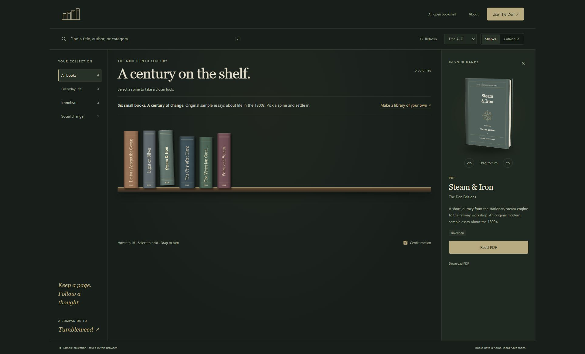

# The Den

A quiet home for your books. Hover over a spine, take a volume off the shelf, turn it in your hands, and settle into a page.

**[Open the live demo](https://slimtalian.github.io/theden/)** · [How it works](#how-it-works) · [Make it yours](#make-it-yours)

The Den is a local library companion to [Tumbleweed](https://slimtalian.github.io/tumbleweed/): books and PDFs here, ideas there. It uses **calibre** to manage your collection and **PDF.js** to render PDFs. There is no account, subscription, telemetry, or automatic cloud sync.



## How it works

- The same 3D binding sits on the shelf and turns in your hands. Full spine titles wrap and fit the binding, keeping edition and volume names visible. Slide a finger across the spines to lift each book, or hover with a mouse. Pause for a moment to draw out the cover and its library blurb; release your finger or move away to return it. A quick tap or click opens the book. Keyboard focus also previews; Escape dismisses it. Books without descriptions show their title and author.
- Browse with the brass category labels above the shelf. On a phone, slide the labels to explore them or swipe empty shelf space to change category. Books glide into place while the labels and shelves stay anchored. Search by title, author, series, or category, and switch between shelves and a compact catalogue. **Library** holds sorting, motion, and management tools.
- Every book wears a custom cloth cover matching its spine, with its title and original gold linework inspired by the subject. Turn off **Details → Cloth jacket** to show the original artwork for a book. This preference stays in the browser; original files and calibre covers are unchanged.
- Read PDFs with continuous vertical scrolling or page-by-page navigation. In page mode, click the paper's left or right edge; fitted pages also support touch swipes. Zoomed pages remain pannable.
- A library ladder reveals a full-screen book view when you select a spine, and sweeps back when you return. The same transition opens and closes the reader; PDF page turns stay subtle. Gentle motion and the system's reduced-motion setting are respected.
- Resume a PDF at its saved page. Zoom, rotation, and orientation changes preserve your reading page. Download the untouched original whenever you need it.
- On mobile, spines respond to touch and the book follows your horizontal drag before settling with momentum. Vertical scrolling and pinch gestures stay native. Reading controls sit at the bottom; **•••** opens zoom, rotation, and download without shifting the PDF. Returning from a book restores your place on the shelves.
- In the local app, import PDFs and EPUBs and edit their metadata through calibre. EPUBs open in calibre's desktop reader.

## Demo and local library

| | GitHub Pages demo | Your local app |
| --- | --- | --- |
| Books | Six original short essays about the 1800s | Starts empty; add your own |
| Library management | Read-only sample collection | calibre, with a separate managed library |
| Reading positions | This browser's local storage | Local JSON, with a previous-state backup |
| Imports | Unavailable; nothing is uploaded | PDF and EPUB, up to 100 MB each |
| Server | Static files on GitHub Pages | Node.js on your computer |

The samples are modern introductory essays, not recovered nineteenth-century texts. Each PDF has a cover, two short reading sections, and source notes. Covers and writing were made for this demo. The collection is never automatically imported into your local library.

## Make it yours

Install [Node.js](https://nodejs.org/) **22.13 or newer** (24 recommended) and [calibre](https://calibre-ebook.com/download). Then:

```sh
git clone https://github.com/slimtalian/theden.git
cd theden
npm ci
npm start
```

With `npm start`, open **http://127.0.0.1:4317/**. On Windows, after installing dependencies, **Start The Den.cmd** starts the server on **0.0.0.0:4317** and opens this PC's network address. Use the printed network address on another device on the same network. **Stop The Den.cmd** stops this project's recorded process with either binding. The launcher verifies the project owning the port and will not stop another app.

`0.0.0.0` is a listening address, not a browser destination. The launcher uses localhost for its startup check and as a fallback when no network address is available. For local-only use, stop The Den and run `powershell -NoProfile -ExecutionPolicy Bypass -File .\start-den.ps1 -LocalOnly`. If an existing process uses a different binding, Start asks you to stop it first.

Add a PDF or EPUB using **Add books**, or drop it onto the shelves. Files are copied into your own library; their originals are not moved. Use **Library → Open this library in calibre** for more detailed management, then **Refresh** in The Den.

Windows is the primary locally tested platform. The server also supports calibre in the standard macOS application location and command-line executables on Linux's `PATH`. The Windows launchers are optional; `npm start` works on all supported Node platforms. CI tests the server against Linux calibre.

### Optional configuration

Defaults work without configuration. Copy `config.example.json` to **config.local.json** only if needed. Relative paths are resolved from the project folder. The example uses a separate library under `data/library` and loopback-only access for `npm start`. The Windows launcher explicitly chooses network access by default, or loopback with `-LocalOnly`.

For a nonstandard calibre installation, add a `calibreDirectory` field pointing to its executable directory. On Windows, use a short project/library path; calibre has a conservative 74-character limit for the library root in this app.

To use a phone on a **trusted local network**, use the Windows launcher, or set `host` to `0.0.0.0` and restart with `npm start`. The console prints available network URLs. This prototype has no user authentication: anyone with network access to it can read and manage that library. Keep it off the public internet. Binding to `127.0.0.1` accepts this computer only.

The terminal server also accepts `DEN_PORT`, `DEN_HOST`, `DEN_DATA_DIR`, and `CALIBRE_DIRECTORY`. The Windows launcher uses port 4317. If that port is busy, it refuses to replace the running process.

## Your data

Everything private stays in the local `data/` folder by default:

- `library/`: calibre's database, book copies, covers, and metadata.
- `reading-state.json` and `.bak`: current and previous reading positions, keyed by book UUID, plus import hashes.
- `calibre-config/`, `calibre-temp/`, and `incoming/`: separate settings and temporary work.

The app does not attach or scan your existing calibre library. Choosing a different `libraryPath` explicitly attaches that library and makes metadata edits affect it. Stop The Den and calibre before backing up the entire data directory. Exporting reading positions alone is not a book backup. Unreadable reading-state files are preserved and the previous snapshot is recovered when possible.

`data/`, local configuration, logs, test libraries, and build artifacts are ignored by Git. The Pages build copies an explicit list of application assets and the six demo books; it never copies your data directory. GitHub may collect standard hosting request logs; The Den adds no analytics.

## Development

```sh
npm test                 # Real calibre integration + reading gestures + demo adapter
npm run test:demo        # Demo/gesture tests; no calibre needed
npm run build:demo       # Self-contained static demo in dist/
npm run check:public     # Publication and private-data checks
npm run preview:demo     # http://127.0.0.1:4321/theden/
```

Real integration tests use isolated libraries under `.test-runs/`. They do not import into the active library. The static preview deliberately uses a project subpath to catch GitHub Pages path errors.

The interface is plain HTML, CSS, and JavaScript. `public/library-client.js` connects the same interface to either the local API or the read-only demo adapter. `server.mjs` invokes calibre without a shell and serves the local assets. PDF.js and its worker, fonts, and rendering resources are served locally; the demo build bundles them too.

To regenerate the demo books, install Python's `reportlab` and run `python scripts/generate-demo-books.py`. The editable content and research links are in `demo/books.json`. Regeneration is optional; the finished sample PDFs and SVG covers are included in the repository.

### Publishing your fork

In **Settings → Pages**, choose **GitHub Actions**. The included workflow builds and deploys only `dist/` on pushes to `main`. It uses the repository's built-in `GITHUB_TOKEN`; no personal access token is required. Update the repository/Tumbleweed links if adapting the app for another project.

## Current scope

The Den does not provide PDF annotation editing, OCR/full-text search, a built-in EPUB renderer, shared-user accounts, or automatic Tumbleweed synchronization. Search covers metadata. Reading progress is saved by page, not by precise scroll offset. Local desktop actions open on the server computer, including when the library is viewed from a phone.

## License and credits

[MIT](LICENSE). The sample writing and covers use the same license. PDF.js is [Apache-2.0](https://github.com/mozilla/pdf.js/blob/master/LICENSE), with its license retained in the build. calibre is installed separately and is not redistributed. Source links in the sample books credit research, not copied prose or artwork.
